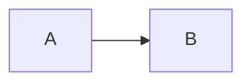

# 🧱 Keystone

> Simple things should be simple, and difficult things should be possible.

Keystone turns a Markdown manuscript into professional-quality **PDF, EPUB, DOCX, and ODT** — one source, every format.
You write plain text, pick a target (`book`, `report`, `article`), and Keystone typesets the result with
[Pandoc](https://pandoc.org/), [XeLaTeX](https://www.latex-project.org/), and a pinned [Docker](https://www.docker.com/)
image. Your book stays diff-able, reviewable, and under version control. No LaTeX expertise is required: you need
[Docker](https://www.docker.com/) and [GNU Make](https://www.gnu.org/software/make/).

📚 **The author's manual is at <https://keystone.knight-owl.dev/>** — writing, configuration, and the shortcut reference
all live there.

## This template

`core-diagrams` is [`core-slim`](https://github.com/knight-owl-dev/keystone-template-core-slim) with diagram rendering
wired in. Write a plain `mermaid` fence and it becomes a figure; GitHub and your editor still preview it as a diagram,
because nothing marks it for Keystone.

````markdown

````

Wrap it in [`aligned-figure`](https://keystone.knight-owl.dev/shortcuts/reference/#aligned-figure) to give it a width,
an alignment, or an id to link to.

The renderer is a second container the compose file wires alongside the engine — a
[hook](https://keystone.knight-owl.dev/hooks/), which is how Keystone extends without an engine change.
[Diagrams](https://keystone.knight-owl.dev/writing/diagrams/) covers what you can write.

To read or change the engine itself, use
[`keystone-template-core`](https://github.com/knight-owl-dev/keystone-template-core), which ships the entire runtime in
your project — see [Choosing a template](https://keystone.knight-owl.dev/templates/).

## Quick start

**1. Make it yours.** Use the **Use this template** button on GitHub, or download the source and put it under whatever
version control you prefer.

**2. Configure.** [`project.conf`](project.conf) names the project and sets how it builds; [`pandoc.yaml`](pandoc.yaml)
holds the document metadata — title, author, target, page layout, fonts, cover image.

**3. Write.** Markdown goes in `manuscript/`, images in `assets/`, and [`publish.txt`](publish.txt) lists the files in
reading order. Your own markup vocabulary goes in [`shortcuts.yaml`](shortcuts.yaml).

**4. Build.**

```shell
make publish
```

The finished book lands in `artifacts/`. The [Quickstart](https://keystone.knight-owl.dev/getting-started/quickstart/)
walks this same path in full.

## Commands

```shell
make publish              # build a PDF (default)
make publish format=epub  # pdf | epub | docx | odt
make all                  # PDF, EPUB, and DOCX
make verify               # verify both signed images
make ps                   # show this project's containers
make down                 # stop the renderer when you are done
make reset                # stop it and drop the hook cache
make help                 # the full list of targets
```

The renderer keeps running between builds, which saves the next one a second or so on a fast machine, and it holds a
couple of hundred megabytes while it does. `make down` stops it; `KEYSTONE_HOOKS_KEEP_ALIVE=false` in
[`project.conf`](project.conf) has every build stop it for you. What makes a rebuild quick is the cache — a diagram
already rendered is not rendered again — and stopping the renderer leaves it alone. `make reset` is what drops it.

The first build pulls the runtime and hook images; later builds reuse them. The renderer's healthcheck uses
`start_interval`, so this template needs Docker Engine 25 or newer. `make verify` checks both cosign signatures —
[Verifying your download](https://keystone.knight-owl.dev/getting-started/verifying/) covers that and how to read an
image's SBOM.

## Learn more

- [`core-diagrams`](https://keystone.knight-owl.dev/core-diagrams/) — this template in full: every command, its options,
  and how to move onto a newer release.
- [Diagrams](https://keystone.knight-owl.dev/writing/diagrams/) — what you can write in a claimed fence, and how the
  figure around it is styled.
- [Upgrading your project](https://keystone.knight-owl.dev/upgrading/) — what changes when a new Keystone release lands.
- [Writing](https://keystone.knight-owl.dev/writing/manuscript/) — dialogue, scene breaks, figures, typography, and
  every other authoring task.
- [Book metadata](https://keystone.knight-owl.dev/configuration/metadata/) — everything `pandoc.yaml` controls.
- [Project settings](https://keystone.knight-owl.dev/configuration/project-conf/) — everything `project.conf` controls.
- [Shortcuts](https://keystone.knight-owl.dev/shortcuts/) — Keystone's styling API, and how to build your own vocabulary
  on top of it.
- [Project anatomy](https://keystone.knight-owl.dev/getting-started/project-anatomy/) — what each file and directory is
  for.
- [Importing a draft](https://keystone.knight-owl.dev/getting-started/import/) — bring an existing DOCX, ODT, or RTF
  into Markdown.
- [keystone-hello-world](https://github.com/knight-owl-dev/keystone-hello-world) — a complete sample project, if you
  would rather read one than a guide.

## License

Keystone is released under [CC BY-NC-SA 4.0](https://creativecommons.org/licenses/by-nc-sa/4.0/): use it to make your
own books, share and adapt it under the same terms, but do not repackage it as a commercial product. The binding terms
are in [`.licenses/Keystone.md`](.licenses/Keystone.md); the summary, and the notices for Pandoc, LaTeX, and the bundled
fonts, are in [License & attribution](https://keystone.knight-owl.dev/license/).

Keystone is built on Pandoc, LaTeX, Docker, GNU Make, and Lua — freely given work that made all of this possible. Keep
the `.licenses/` and `NOTICE.md` notices in place.

Developed and maintained by [Knight Owl LLC](https://github.com/knight-owl-dev).
